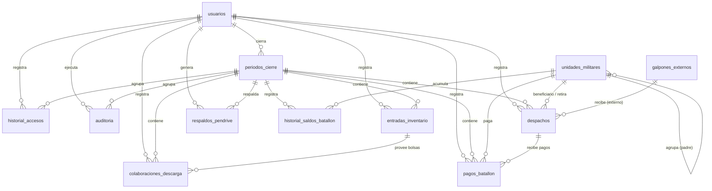

# Documentación Técnica y Académica — Sistema Almacén de Alimentos CLAP

> **Sistema Web Local 100% Offline de Control de Inventario, Despachos, Pagos y Rendición de Cuentas**  
> Sede: Almacén de Alimentos CLAP · Ejército Bolivariano (Fuerte Tiuna, Caracas)

---

## 1. Arquitectura General del Sistema

El sistema sigue un patrón **MVC ligero (Modelo–Vista–Controlador)** optimizado para equipos de escritorio con recursos limitados (Windows 7+, 2 GB de RAM, sin conexión a internet):

* **Capa de Presentación (Vista):** Plantillas HTML5 / Jinja2 con diseño institucional responsivo (`app/templates/` y `app/static/style.css`) y JavaScript nativo sin librerías pesadas externas.
* **Capa de Lógica de Negocio (Controlador):** Servidor web **Flask** en Python (`app/app.py`) acompañado de utilidades de exportación Excel/PDF (`app/exporter.py`).
* **Capa de Acceso a Datos (DAL):** Módulo `app/db.py` conectado mediante el driver **PyMySQL** (`DictCursor`, codificación `utf8mb4` y control transaccional `autocommit=False`).
* **Capa de Persistencia (Base de Datos):** Motor relacional **MariaDB 10.4** (`almacen_clap_ejercito`) con integridad referencial InnoDB, procedimientos almacenados, triggers y vistas optimizadas.

```
Navegador Local (http://127.0.0.1:5000)
        │
        ▼ HTTP (Flask - app.py)
        ├── Gestión de sesión y roles (MASTER / OPERADOR)
        ├── Validaciones, lógica de despachos y auditoría
        ├── Generación de reportes (.xlsx y .pdf en exporter.py)
        │
        ▼ PyMySQL (1 conexión por petición vía flask.g)
   MariaDB 10.4 (127.0.0.1:3306 · almacen_clap_ejercito)
        └── 13 tablas InnoDB + 4 vistas + 7 triggers + 1 procedimiento almacenado
```

---

## 2. Estructura de Carpetas y Responsabilidad de Cada Archivo

| Ruta | Responsabilidad principal |
|---|---|
| `app/app.py` | Controlador principal Flask: rutas HTTP, autenticación, gestión de conexión por petición (`flask.g`), reglas de negocio y auditoría. |
| `app/db.py` | Capa de Acceso a Datos (DAL): conexión `PyMySQL`, caché de `config.json`, hashing PBKDF2-SHA256, validadores y humanización de auditoría. |
| `app/exporter.py` | Exportador local hacia carpeta o Pendrive USB: genera reportes completos en Excel (`.xlsx`, 7 hojas) y resumen ejecutivo en PDF (`.pdf`). |
| `app/config.json` | Parámetros locales de conexión a MariaDB (`db_host`, `db_port`, `db_user`, `db_password`, `db_name`) y servidor Flask (`127.0.0.1:5000`). |
| `app/Iniciar_Almacen_CLAP.bat` | Lanzador en Windows: posiciona la carpeta, abre el navegador en `http://127.0.0.1:5000` e inicia el servidor local `python app.py`. |
| `app/templates/base.html` | Plantilla base compartida: barra institucional, barra de navegación y scripts globales (campos observación, números, PIN `.pin-9` y `.form-anular`). |
| `app/templates/*.html` | Vistas específicas: `login.html`, `dashboard.html`, `entradas.html`, `colaboraciones.html`, `despachos.html`, `pagos.html`, `catalogos.html`, `usuarios.html`, `auditoria.html`, `cierre.html`. |
| `app/static/style.css` | Hoja de estilos única offline con variables CSS institucionales, tarjetas KPI, tablas, combobox predictivo y formularios de pago. |
| `tools/schema_base.sql` | Esquema fuente DDL documentado con índices, triggers, procedimiento almacenado y vistas optimizadas. |
| `tools/generar_sql.py` | Script utilitario que combina `tools/schema_base.sql` y `Dis_unidad.xlsx` para regenerar `schema.sql`. |
| `schema.sql` | Script SQL final auto-contenido para desplegar la base de datos desde cero con sus 94 unidades militares. |
| `test_schema.sql` | Script de pruebas SQL automáticas ejecutado dentro de una transacción con `ROLLBACK`. |

---

## 3. Flujo de Conexión a la Base de Datos y Control Transaccional

Para garantizar velocidad y cero fugas de conexiones en un equipo de bajos recursos, el ciclo de vida de cada petición web funciona así:

1. **Lectura cacheada de configuración (`db.py -> load_config`):** `config.json` se lee una sola vez en memoria (`_CONFIG_CACHE`), verificando únicamente su fecha de modificación (`mtime`).
2. **Apertura perezosa de una sola conexión por petición (`app.py -> get_db`):** Cuando una ruta consulta la base de datos por primera vez, `get_db()` llama a `db.get_conn()` y almacena la conexión en `flask.g.db`.
3. **Caché de contexto por petición (`get_req_period` / `get_req_stock`):** El procesador global de plantillas (`inject_globals`) reutiliza desde `flask.g` el período abierto y el stock calculado por la ruta principal, evitando abrir una segunda conexión o repetir consultas en la misma carga de página.
4. **Atomicidad ACID:** PyMySQL trabaja con `autocommit=False`. Las operaciones multi-tabla (ej. registrar un despacho + insertar pagos + marcar despachos previos como arrastrados + registrar auditoría) se consolidan juntas mediante `conn.commit()`. Ante cualquier error, `conn.rollback()` deshace toda la operación.
5. **Cierre garantizado (`@app.teardown_appcontext -> close_db`):** Al concluir la petición HTTP (exista o no excepción), Flask invoca automáticamente `close_db()`, ejecutando `rollback()` en caso de error y cerrando la conexión TCP con MariaDB.

---

## 4. Diagrama Entidad–Relación de la Base de Datos



---

## 5. Diccionario Resumido de Tablas, Vistas, Triggers y Procedimientos

### 5.1 Las 13 Tablas InnoDB
| # | Tabla | Propósito |
|---|---|---|
| 1 | `usuarios` | Cuentas de acceso (`MASTER` y hasta 3 `OPERADOR`), hash PBKDF2-SHA256 y `pin_seguridad` (1–9 dígitos). |
| 2 | `configuracion_sistema` | Parámetros persistentes clave-valor (ej. `ultima_ruta_respaldo`). |
| 3 | `periodos_cierre` | Períodos operativos mensuales/manuales (`ABIERTO` / `CERRADO`), precio vigente de bolsa y totales congelados al cierre. |
| 4 | `historial_accesos` | Registro de seguridad de cada `LOGIN_OK`, `LOGIN_FALLIDO` y `LOGOUT` con fecha y usuario digitado. |
| 5 | `auditoria` | Bitácora trazable con valores anteriores/nuevos en JSON (`CREAR`, `EDITAR`, `ANULAR`, `CIERRE`, `AJUSTE`, `CONFIG`). |
| 6 | `unidades_militares` | Catálogo de 94 batallones/unidades militares, jerarquía agrupadora y `saldo_acumulado_bs`. |
| 7 | `galpones_externos` | Catálogo de galpones nacionales destino de despachos externos. |
| 8 | `entradas_inventario` | Recepciones de lotes de bolsas CLAP ingresados al almacén (sujetas a anulación lógica). |
| 9 | `colaboraciones_descarga` | Salidas de bolsas otorgadas por apoyo en descarga, asociadas obligatoriamente a un lote específico. |
| 10 | `despachos` | Salidas internas a batallones (`INTERNO_BATALLON`) o externas a galpones (`EXTERNO_GALPON`), con su liquidación financiera completa. |
| 11 | `pagos_batallon` | Pagos múltiples y abonos complementarios por despacho con concepto personalizable y referencia bancaria. |
| 12 | `historial_saldos_batallon` | Movimientos de aplicación y arrastre de saldos a favor o deudas entre despachos y cierres. |
| 13 | `respaldos_pendrive` | Historial de archivos `.xlsx` y `.pdf` generados en respaldos rápidos o cierres de período. |

### 5.2 Las 4 Vistas Optimizadas (JOINs agrupados de una sola pasada)
* `v_inventario_periodo`: Resume por período el stock inicial, entradas activas, despachos internos (Familiar/Tango/Total), despachos externos y colaboraciones mediante `LEFT JOIN` agrupados (`GROUP BY id_periodo`).
* `v_stock_disponible`: Calcula el stock físico disponible restando todas las salidas activas del stock inicial más entradas.
* `v_conciliacion_batallones`: Presenta cada despacho interno con nombres de unidad beneficiaria y retirante, liquidación y referencias concatenadas (`GROUP_CONCAT`).
* `v_rendicion_cuentas`: Consolida en una sola lectura el stock disponible, monto esperado, monto cobrado, deudas pendientes y saldos a favor por período.

### 5.3 Procedimiento Almacenado y Triggers
* **Procedimiento `sp_recalcular_despacho(p_id)`:** Suma pagos activos de `pagos_batallon`, actualiza en una sola escritura `monto_total_pagado_bs`, `monto_neto_exigible_bs`, `diferencia_saldo_bs` y `estado_financiero` del despacho, y recalcula `saldo_acumulado_bs` del batallón beneficiario.
* **Triggers de recálculo automático:** `trg_pagos_ai` y `trg_pagos_au` invocan `sp_recalcular_despacho` tras insertar o modificar un pago.
* **Triggers de inmutabilidad (`BEFORE DELETE`):** `trg_desp_bd`, `trg_pagos_bd`, `trg_ent_bd` y `trg_col_bd` bloquean cualquier `DELETE` directo en base de datos, forzando anulación auditada.
* **Trigger de cupo de usuarios (`trg_usuarios_max4`):** Limita el total del sistema a 4 usuarios y a 1 solo usuario `MASTER`.

---

## 6. Reglas de Seguridad y Operación

1. **Autenticación y roles:** Las contraseñas se cifran con PBKDF2-SHA256 (`200.000` iteraciones + sal aleatoria). El rol `OPERADOR` registra y edita movimientos diarios; solo el rol `MASTER` accede a Catálogos, Usuarios, Auditoría, Cierre Manual y Anulaciones.
2. **Código de seguridad Master (PIN):** Toda anulación (entradas, colaboraciones, despachos, pagos) y actualización de contraseña Master requiere el código numérico secreto (1–9 dígitos) validado con `hmac.compare_digest`.
3. **Trazabilidad financiera automática:**
   * Si un batallón paga **de menos** (`diferencia_saldo_bs < 0`), el faltante se registra como deuda acumulada y se suma al próximo despacho.
   * Si paga **de más** (`diferencia_saldo_bs > 0`), el excedente se guarda como saldo a favor y se descuenta automáticamente en el próximo despacho, mostrando enlaces bidireccionales entre el despacho origen y el receptor.
4. **Cierre manual de período:** Congela cifras en `periodos_cierre`, traslada el `stock_disponible` y los saldos pendientes al nuevo período y genera los reportes Excel y PDF sin pérdida histórica.

---

## 7. Guía Rápida de Instalación, Pruebas y Arranque

1. **Requisitos:** Python 3.10+ (`flask`, `pymysql`, `openpyxl`, `fpdf2`), MariaDB 10.4 local en puerto `3306`.
2. **Instalación de BD:**
   ```cmd
   mysql -u root -p --default-character-set=utf8mb4 < "C:\Almacén de Alimentos\schema.sql"
   ```
3. **Pruebas unitarias SQL (seguras, usan `ROLLBACK`):**
   ```cmd
   mysql -u root -p --default-character-set=utf8mb4 -t < "C:\Almacén de Alimentos\test_schema.sql"
   ```
4. **Inicio de la aplicación:**
   Hacer doble clic en `app\Iniciar_Almacen_CLAP.bat` o ejecutar en consola:
   ```cmd
   cd /d "C:\Almacén de Alimentos\app"
   python app.py
   ```
   Luego abrir `http://127.0.0.1:5000` (usuario inicial: `master` / contraseña inicial: `Alfa01`).
